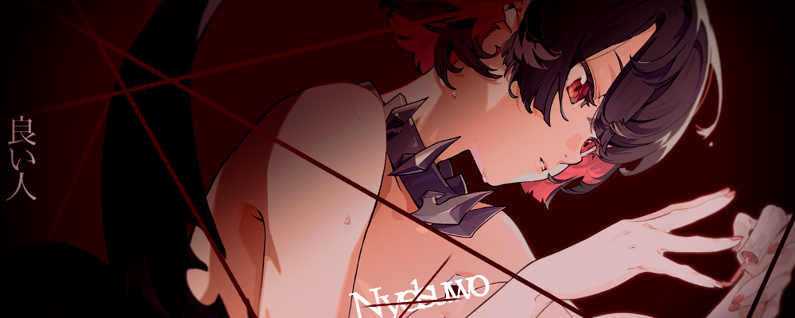

# GTA: San Andreas Project Files

**A personal SA-MP archive and project collection by nYel**

---

## 📌 About

This repository is a personal backup and archive of SA-MP (San Andreas Multiplayer) files and custom projects by **nYel**.
Created on **October 20, 2026**, it preserves nostalgic memories, configurations, and packs for future reference.

## 📥 Downloads

| Pack | Format | Download |
| :--- | :----: | :------- |
| 📁 **GTA WARGA STIT SIT** | `.rar` | [Download on MediaFire](https://www.mediafire.com/file/ij748ibj91mmzv0/GTA+WARGA+STIT+SIT+By+Nyelwest.rar/file) |
| 📁 **GTA ROBARY BY IWIR JAWIER** | `.rar` | [Download on MediaFire](https://www.mediafire.com/file/cgku3nsk8gz8376/GTA+ROBARY+BY+IWIR+JAWIER.rar/file) |

> [!NOTE]
> Both packs are `.rar` archives. Extract them with [7-Zip](https://www.7-zip.org/) or WinRAR.

## 🛠️ Installation

1.provide sufficient storage then extract to local disk: c.

2. Open the extracted folder and look for **SAMP.EXE**.
3. open and enter your username on your server.
4. Pay attention to files such as lua, cs, asi to avoid your account being hacked or banned due to the use of illegal files. 

> [!IMPORTANT]
> No need to delete any GTA folders you have, just run it, if it crashes, delete some files that you think are useless.

## ❓ FAQ

<b>The archive won't open or says it's corrupted</b>

 
Update to the latest 7-Zip or WinRAR and download the file again. If it still fails, tell me on Discord.

<b>My antivirus flags a file</b>

 
Game plugins (<code>.asi</code>, <code>.dll</code>, CLEO) often trigger false positives. If you're unsure, scan the file on <a href="https://www.virustotal.com/">VirusTotal</a> first and don't run it if you're not comfortable.

<b>The MediaFire link is dead</b>

 
Message me on Discord and I'll re-upload it.

## 🌐 Connect With Me

| Platform | Link |
| :------- | :--- |
| ▶️ YouTube | [@nyelsu](https://youtube.com/@nyelsu) |
| 💬 Discord Community | [Join Server](https://discord.gg/R8rzBdDa4p) |
| 📨 Direct Message | [Add on Discord](https://discord.com/users/1145608106533982258) |

## ⚠️ Disclaimer

- This project is **not affiliated** with Rockstar Games, Take-Two Interactive, or the SA-MP team.
- *Grand Theft Auto* and *San Andreas* are trademarks of their respective owners.
- Shared for archival purposes only. Use at your own risk.
- If you are a rights holder and want something removed, contact me on Discord and it will be taken down promptly.

---

  Archived with ❤️ by <strong>nYel</strong> • 2026

